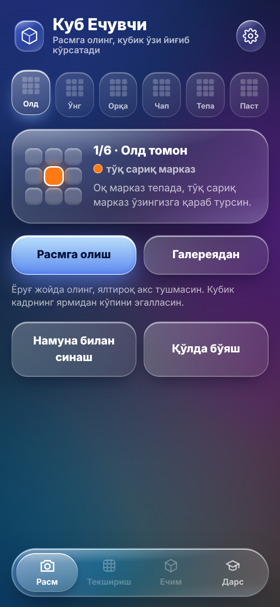
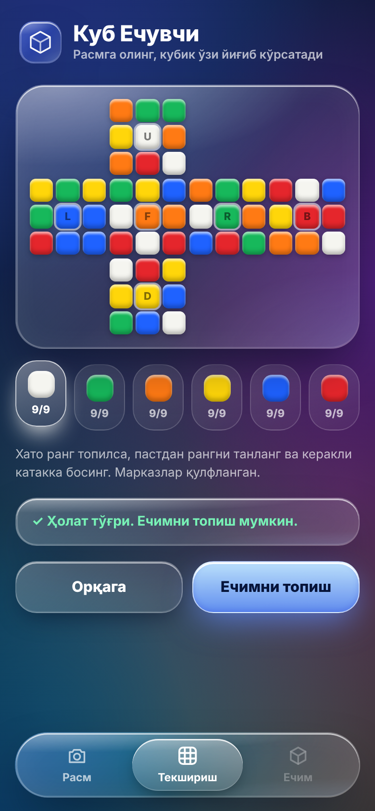
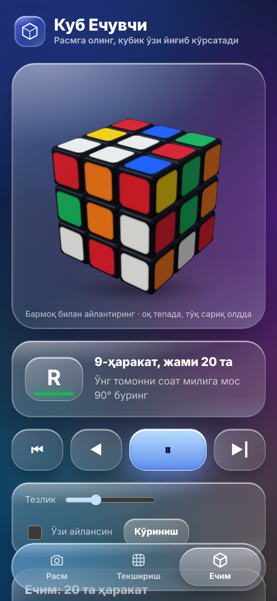
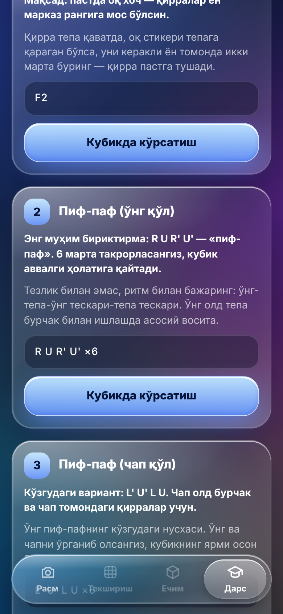
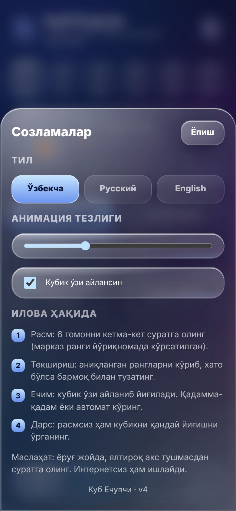

<p align="center"><a href="README.md">🇬🇧 English</a> · <a href="README.ru.md">🇷🇺 Русский</a> · <a href="README.uz.md">🇺🇿 Ўзбекча</a></p>

<div align="center">

# 🧊 CubikRubik

**Photograph your Rubik's cube — the app finds the solution and shows it by rotating a 3D cube.**


    

</div>

## ✨ Features

- 📸 **Scan 6 faces** with on-screen guidance and a colour-coded centre hint.
- 🎨 **Automatic colour detection** in LAB colour space, anchored on the centres. Fix any mistake by hand.
- 🧠 **Fast solver** — Kociemba two-phase algorithm, usually around 20 moves. Runs in a Web Worker so the UI never freezes.
- 🧊 **Smooth 3D cube** — custom WebGL2 renderer, eased animation, drag to rotate.
- ▶️ **Step-by-step playback** — play, pause, step forward/back, speed control, jump from the move list.
- 🪟 **Liquid Glass design** — glass panels, specular highlights, floating glass dock.
- 🌍 **3 languages** — Ўзбекча (Cyrillic), Русский, English. Chosen from the device language; change it in ⚙ Settings.
- 🎓 **Learn tab** — works without photos: the "pif-paf" (R U R' U') and 8 more lessons, each demonstrated on the 3D cube, plus a random-scramble practice mode.
- ⚙️ **Settings** — language, animation speed, auto-rotate and a short guide to the app.
- 📴 **Works offline** — everything is bundled.

## 📲 Download the APK (Android)

1. Open **[Releases](../../releases/latest)** on the right side of this repo.
2. Download **`CubikRubik-vX.Y.Z.apk`** from the latest release and install it (Android may ask you to allow "Install from unknown sources").

> A new release is built automatically by GitHub Actions whenever a tag like `vX.Y.Z` is pushed. Every push also produces an APK under **Actions → Build APK → Artifacts**.

## 🍎 iPhone

There is no APK for iPhone. Open the web version in Safari and choose **Share → Add to Home Screen** — it opens full screen like an app.

## 🧭 How to use

| Step | What you do |
|---|---|
| **1. Photo** | Photograph the front, right, back, left, top and bottom faces in turn. The cube should fill over half the frame, in good light. |
| **2. Check** | Review the detected colours; to fix one, pick a colour and tap the cell. Each colour must appear 9 times. |
| **3. Solve** | Tap "Find solution". The cube rotates itself to solve; the move list sits below. |
| **4. Learn** | No photos needed — pick a lesson and watch the algorithm on the 3D cube. |

Tip: tap **"Try an example"** on the first screen to test it quickly.

## 🏗 Project structure

```
CubikRubik/
├─ app/src/main/assets/index.html            ← the whole app (UI + solver + WebGL cube)
├─ app/src/main/java/.../MainActivity.java   ← WebView, camera / gallery
├─ .github/workflows/build.yml               ← APK build + GitHub Release
└─ docs/                                     ← screenshots
```

The app is a single `index.html` web app running inside an Android `WebView`; you can also open it in any browser.

## 🔧 Build manually

Requirements: JDK 17, Android SDK 34, Gradle 8.7.

```bash
gradle assembleDebug
# output: app/build/outputs/apk/debug/app-debug.apk
```

## 🧪 Technical notes

- The cube state is read in `URFDLB` facelet order and validated (twist, flip, permutation parity).
- Solver: twist, flip and UD-slice coordinates, BFS pruning tables, IDA* search.
- Renderer: rounded-box mesh, SDF stickers, procedural reflections, `requestAnimationFrame` timeline.
- Photos: EXIF orientation is handled manually so rotated camera images are read correctly.

## 📄 License

MIT
