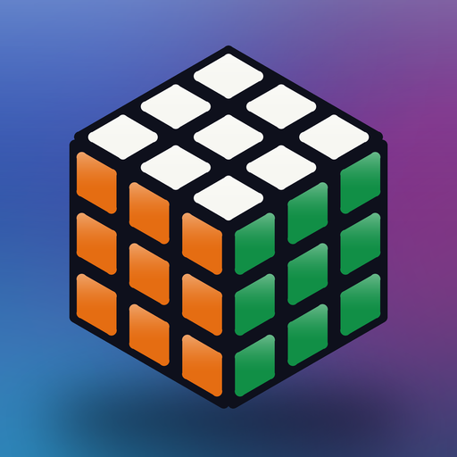
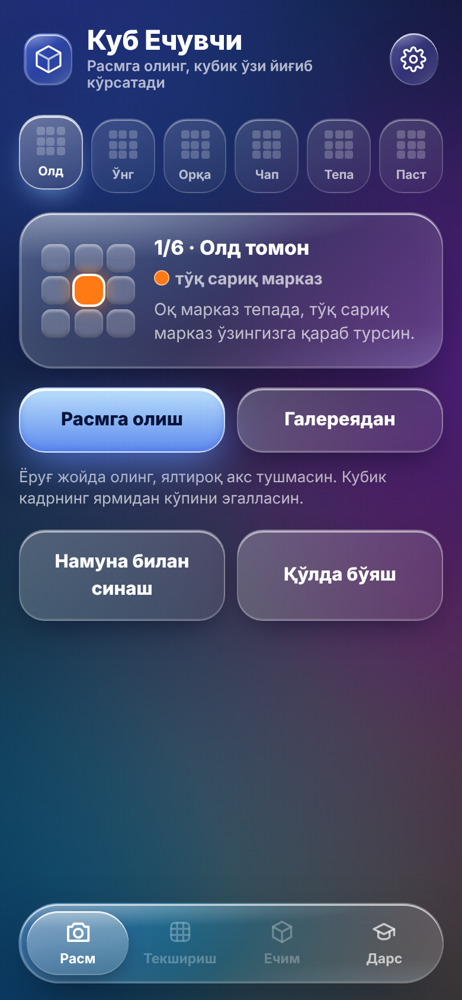
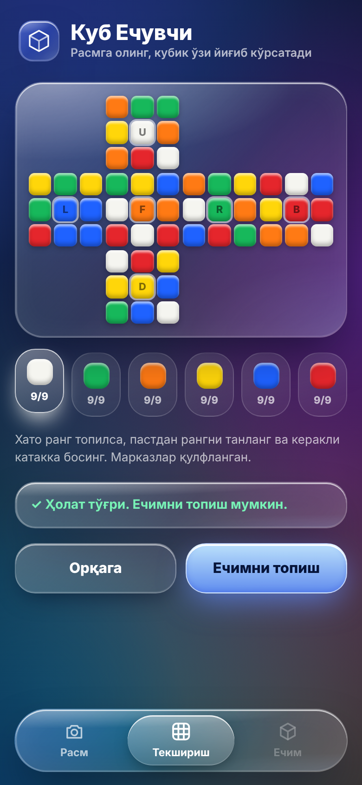
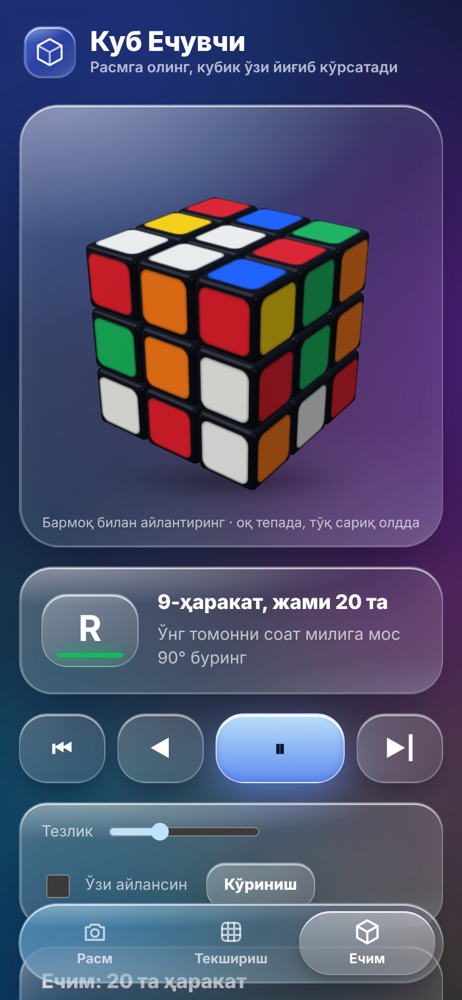
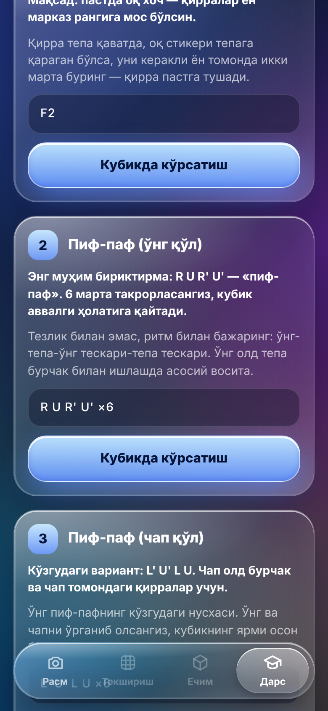
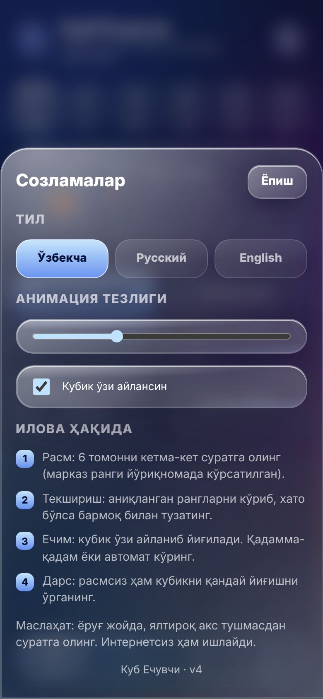

<p align="center"><a href="README.md">🇬🇧 English</a> · <a href="README.ru.md">🇷🇺 Русский</a> · <a href="README.uz.md">🇺🇿 Ўзбекча</a></p>

<div align="center">

<br>

# CubikRubik

**Сфотографируйте кубик Рубика — приложение найдёт решение и покажет его на вращающемся 3D-кубике.**


    

</div>

## ✨ Возможности

- 📸 **Съёмка 6 граней** с подсказками и цветом нужного центра.
- 🎨 **Автоопределение цветов** в цветовом пространстве LAB по центрам. Ошибки можно исправить вручную.
- 🧠 **Быстрый решатель** — двухфазный алгоритм Коциембы, обычно около 20 ходов. Работает в Web Worker, интерфейс не зависает.
- 🧊 **Плавный 3D-кубик** — собственный WebGL2-рендерер, плавная анимация, вращение пальцем.
- ▶️ **Пошаговый показ** — пуск, пауза, шаг вперёд/назад, скорость, переход по списку ходов.
- 🪟 **Дизайн Liquid Glass** — стеклянные панели, блики, плавающая стеклянная панель навигации.
- 🌍 **3 языка** — Ўзбекча (кириллица), Русский, English. Язык выбирается по языку устройства, меняется в ⚙ Настройках.
- 🎓 **Вкладка «Учёба»** — работает без фото: «пиф-паф» (R U R' U') и ещё 8 уроков, каждый показан на 3D-кубике, плюс тренировка со случайным перемешиванием.
- ⚙️ **Настройки** — язык, скорость анимации, автовращение и краткая справка о приложении.
- 📴 **Работает без интернета** — всё внутри приложения.

## 📲 Скачать APK (Android)

1. Откройте раздел **[Releases](../../releases/latest)** справа в репозитории.
2. Скачайте из последнего релиза файл **`CubikRubik-vX.Y.Z.apk`** и установите его (Android может попросить разрешить «Установку из неизвестных источников»).

> Новый релиз собирается автоматически в GitHub Actions при изменении номера в файле `VERSION`. Кроме того, при каждом push APK доступен в **Actions → Build APK → Artifacts**.

## 🍎 iPhone

APK для iPhone не существует. Откройте веб-версию в Safari и выберите **Поделиться → На экран «Домой»** — она запускается на весь экран как приложение.

## 🧭 Как пользоваться

| Шаг | Что делаем |
|---|---|
| **1. Фото** | Поочерёдно снимите переднюю, правую, заднюю, левую, верхнюю и нижнюю грани. Кубик должен занимать больше половины кадра, свет — хороший. |
| **2. Проверка** | Просмотрите распознанные цвета; чтобы исправить, выберите цвет и нажмите на клетку. Каждого цвета должно быть по 9. |
| **3. Решение** | Нажмите «Найти решение». Кубик сам вращается и собирается; список ходов ниже. |
| **4. Учёба** | Фото не нужны — выберите урок и смотрите алгоритм на 3D-кубике. |

Совет: для быстрой проверки нажмите **«Попробовать на примере»** на первом экране.

## 🏗 Структура проекта

```
CubikRubik/
├─ app/src/main/assets/index.html            ← всё приложение (интерфейс + решатель + WebGL-кубик)
├─ app/src/main/java/.../MainActivity.java   ← WebView, камера / галерея
├─ .github/workflows/build.yml               ← сборка APK и GitHub Release
└─ docs/                                     ← скриншоты
```

Приложение — один файл `index.html`, работающий внутри Android `WebView`; его можно открыть и в любом браузере.

## 🔧 Сборка вручную

Требуется: JDK 17, Android SDK 34, Gradle 8.7.

```bash
gradle assembleDebug
# результат: app/build/outputs/apk/debug/app-debug.apk
```

## 🧪 Технические детали

- Состояние кубика читается в порядке `URFDLB` и проверяется (поворот, переворот, чётность перестановки).
- Решатель: координаты twist, flip, UD-slice, таблицы отсечения на основе BFS, поиск IDA*.
- Рендерер: куб с закруглёнными гранями, SDF-наклейки, процедурные отражения, временная шкала на `requestAnimationFrame`.
- Фото: ориентация EXIF обрабатывается вручную, поэтому повёрнутые снимки камеры читаются верно.

## 📄 Лицензия

MIT
