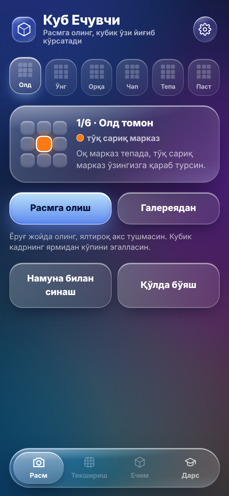
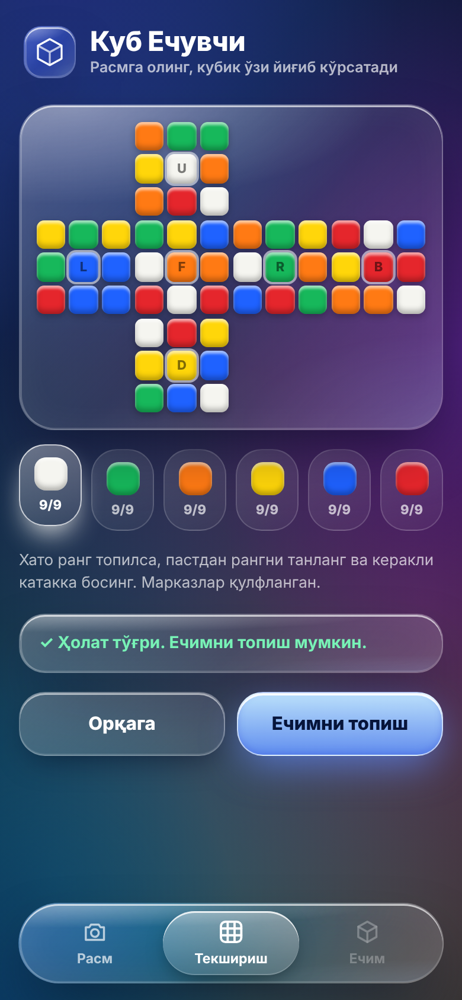
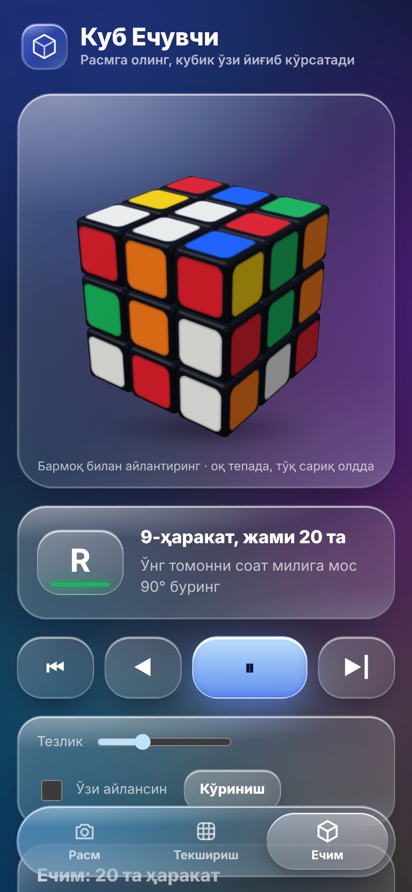
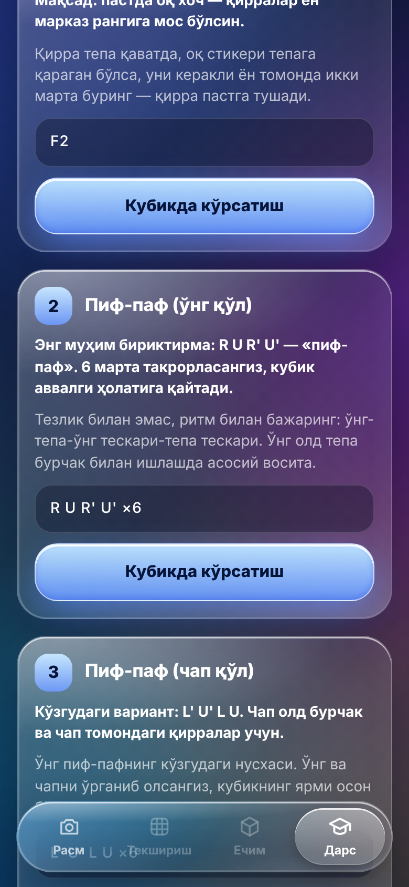
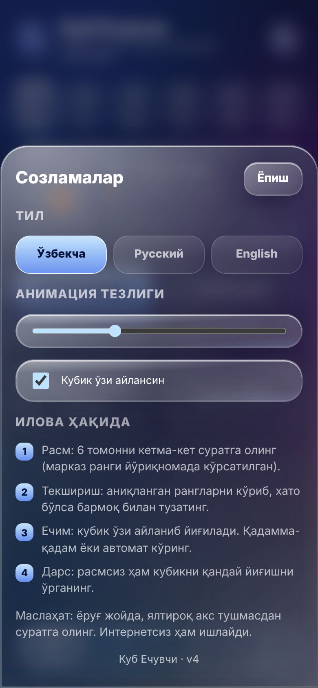

<p align="center"><a href="README.md">🇬🇧 English</a> · <a href="README.ru.md">🇷🇺 Русский</a> · <a href="README.uz.md">🇺🇿 Ўзбекча</a></p>

<div align="center">

# 🧊 CubikRubik

**Рубик кубигини расмга олинг — илова ўзи ечимни топиб, 3D кубикда айлантириб кўрсатади.**


    

</div>

## ✨ Имкониятлар

- 📸 **6 томонни расмга олиш** — ҳар томонга йўриқнома ва рангли йўналтирувчи.
- 🎨 **Рангларни автоматик аниқлаш** — LAB рангли фазода, марказлар бўйича. Хато бўлса, қўлда тузатиш мумкин.
- 🧠 **Тезкор ечувчи** — Kociemba икки фазали алгоритми, одатда 20 га яқин ҳаракат. Ҳисоблаш фонда (Web Worker), экран қотмайди.
- 🧊 **Силлиқ 3D кубик** — ўз WebGL2 рендерери, юмшоқ тезланиш/секинлашиш, бармоқ билан айлантириш.
- ▶️ **Қадамма-қадам кўрсатиш** — ўйнатиш, тўхтатиш, олдинга/орқага, тезликни созлаш, ҳаракат рўйхатидан сакраш.
- 🪟 **Liquid Glass дизайн** — шиша панеллар, ёруғлик акси, пастда шиша навигация.
- 🌍 **3 тил** — Ўзбекча (кирилл), Русский, English. Тил қурилма тилига қараб танланади, ⚙ созламалардан ўзгартирилади.
- 🎓 **Ўрганиш (Дарс) бўлими** — расмсиз ҳам: «пиф-паф» (R U R' U') ва яна 8 та дарс, ҳар бири 3D кубикда кўрсатилади. «Тасодифий аралаштириш» машқи ҳам бор.
- ⚙️ **Созламалар** — тил, анимация тезлиги, автоайланиш ва иловага қисқа йўриқнома.
- 📴 **Интернетсиз ишлайди** — ҳамма нарса илова ичида.

## 📲 APK юклаб олиш (Android)

1. Репода ўнг томондаги **[Releases](../../releases/latest)** бўлимини очинг.
2. Энг охирги релиздан **`CubikRubik-vX.Y.Z.apk`** файлини юклаб, телефонга ўрнатинг (**«Номаълум манбалардан ўрнатиш»** рухсати сўралиши мумкин).

> Янги релиз `vX.Y.Z` кўринишидаги тег қўйилганда GitHub Actions орқали автоматик йиғилади. Ҳар бир push'да йиғилган APK **Actions → Build APK → Artifacts** да ҳам бор.

## 🍎 iPhone

iPhone учун APK йўқ. Ўрнига саҳифани Safari'да очиб, **Улашиш → Бош экранга қўшиш** ни босинг — у иловадек тўлиқ экранда очилади.

## 🧭 Қандай фойдаланилади

| Қадам | Нима қиламиз |
|---|---|
| **1. Расм** | Олд, ўнг, орқа, чап, тепа, паст томонларни кетма-кет расмга оламиз. Кубик кадрнинг ярмидан кўпини эгалласин, ёруғ жой бўлсин. |
| **2. Текшириш** | Аниқланган рангларни кўриб чиқамиз. Хато бўлса, рангни танлаб катакка босамиз. Ҳар ранг 9 тадан бўлиши керак. |
| **3. Ечим** | «Ечимни топиш» босилади. Кубик ўзи айланиб йиғилади, ҳаракат белгилари пастда кўринади. |

Расмсиз ўрганиш учун **Дарс** белгисини босинг. Тезкор синаш учун 1-саҳифадаги **«Намуна билан синаш»** тугмасидан фойдаланинг.

## 🏗 Лойиҳа тузилиши

```
CubikRubik/
├─ app/src/main/assets/index.html   ← бутун илова (UI + ечувчи + WebGL кубик)
├─ app/src/main/java/.../MainActivity.java   ← WebView ва камера/галерея
├─ .github/workflows/build.yml      ← APK автоматик йиғиш
└─ docs/                            ← скриншотлар
```

Илова — битта `index.html` ичидаги веб-илова, Android'да `WebView` ичида ишлайди. Веб-версияни шунчаки браузерда очиш ҳам мумкин.

## 🔧 Қўлда йиғиш

Талаб: JDK 17, Android SDK 34, Gradle 8.7.

```bash
gradle assembleDebug
# natija: app/build/outputs/apk/debug/app-debug.apk
```

## 🧪 Техник тафсилотлар

- Кубик ҳолати расмдан `URFDLB` тартибида ўқилади, ҳолат тўғрилиги (бурилиш, жуфтлик, перестановка) текширилади.
- Ечувчи: twist, flip ва UD-slice координаталари, BFS билан тузилган таянч жадваллар, IDA* қидирув.
- Рендерер: думалоқ қиррали куб, SDF стикерлар, процедуравий акс, `requestAnimationFrame` вақт чизиғи.

## 📄 Лицензия

MIT
